# Design decisions

## T14 — Editorial design system and Home

The site implements direction **A — Editorial** from issue #13: serif display,
sans body, warm paper, one vermillion accent, hairlines and 2px radii. The
tokens live in `src/styles.css`; light and dark are a `prefers-color-scheme`
swap. No webfonts, shadows, gradients or blur.

| Home, English | Light | Dark |
| --- | --- | --- |
| 1280px | 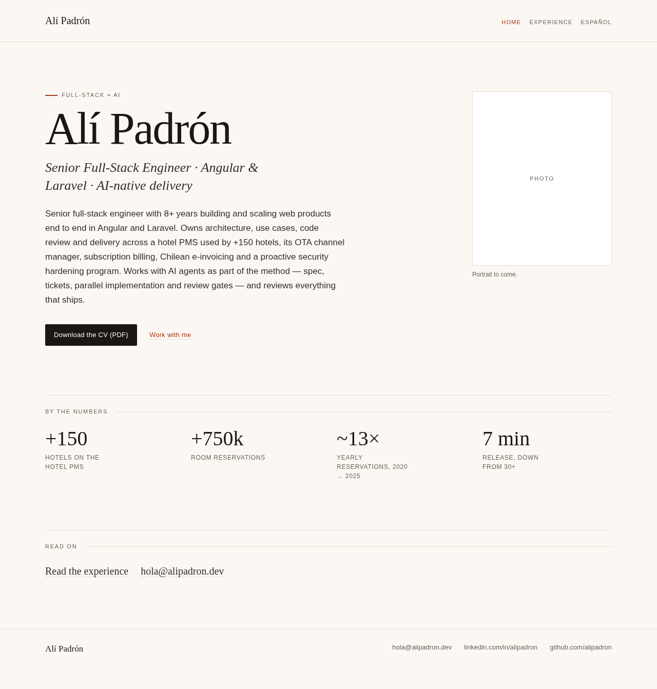 | 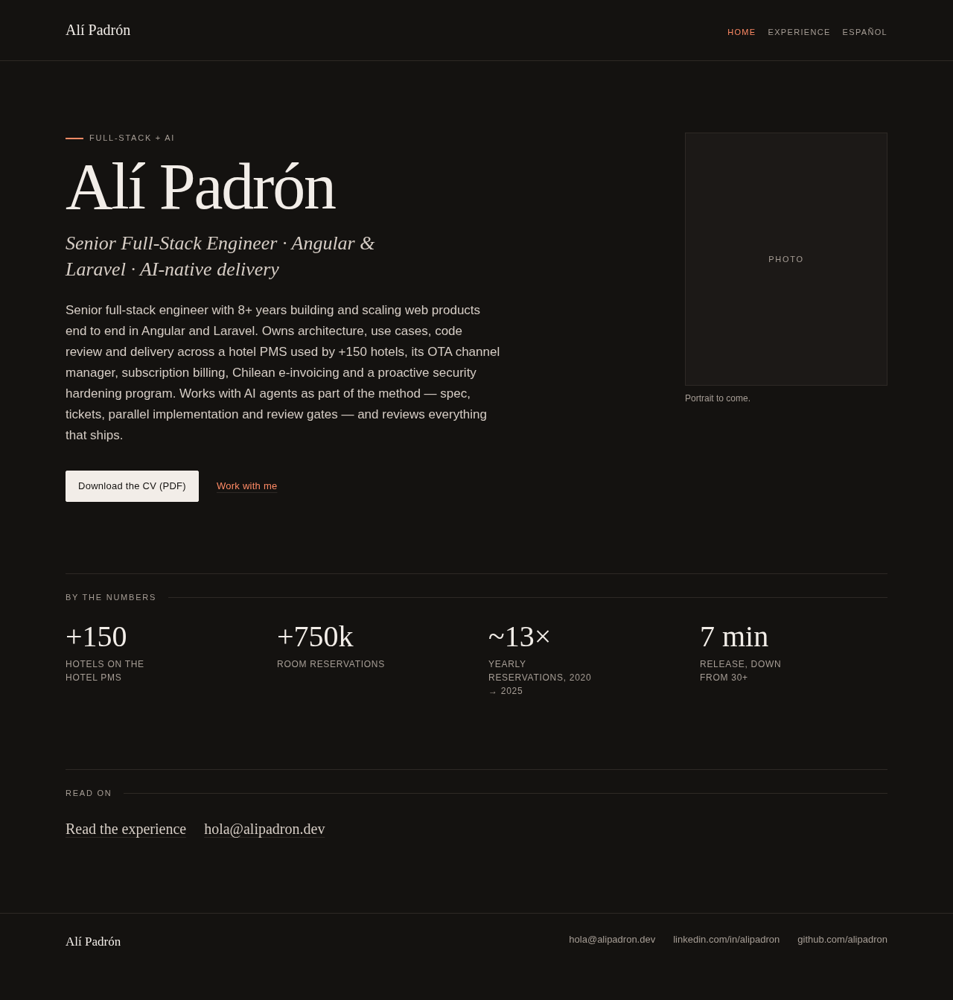 |
| 390px | 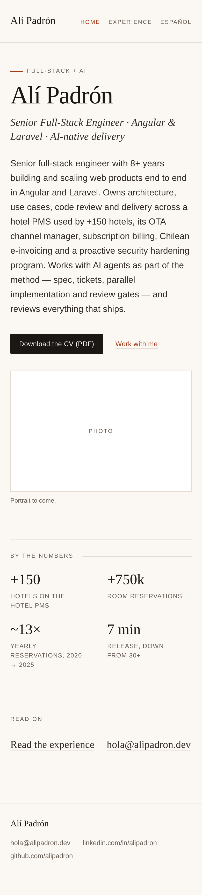 | 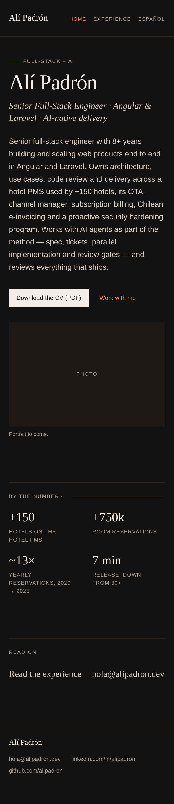 |

Screenshots are of the prerendered build, captured with Playwright. At 390px
the document width stays at 390px (no horizontal scroll), and the first
keyboard stop shows a 2px accent focus outline.

### Photo placeholder

`HomeView.photoSrc` is `null`, which renders the reserved 3:2 phone / 4:5
desktop frame from `src/app/components/portrait.ts`. Set it to a public image
path to swap in the real portrait without changing the layout.

## T15 — How I work, Work with me and Contact

The three long-form pages use the same editorial system with no new tokens. A
page is a title, a leading paragraph and a sequence of ruled sections. Named
services use a definition list, ordered stages are numbered in the margin, and
the contact channels are set in the display serif. All copy is validated
bilingual data in `content/pages.json`, not markup.

| Page | Light 1280 | Dark 1280 | Light 390 | Dark 390 |
| --- | --- | --- | --- | --- |
| How I work | 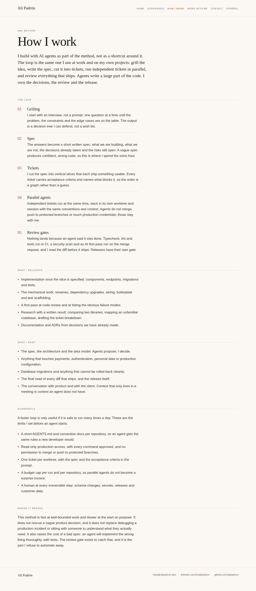 | 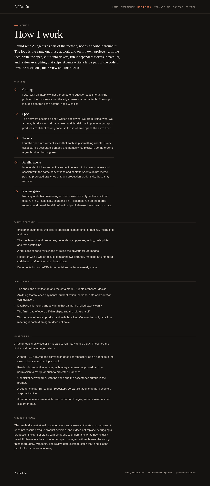 | 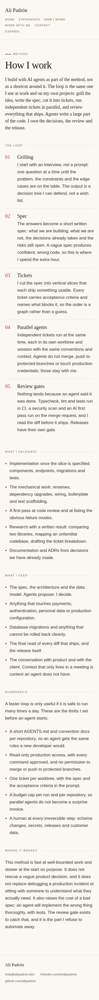 | 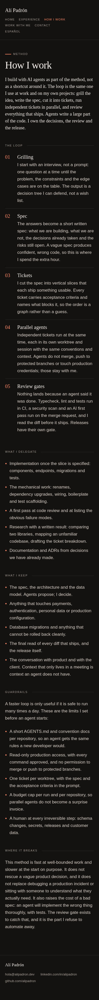 |
| Work with me | 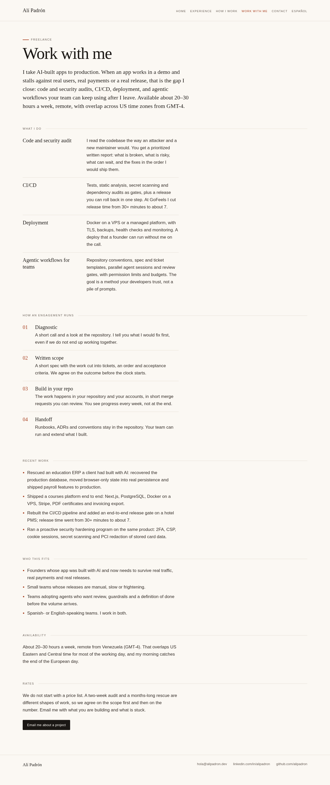 | 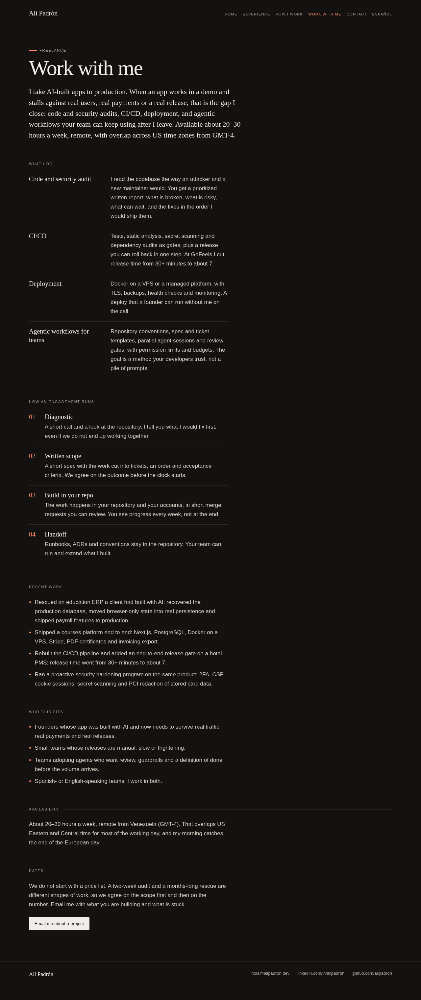 | 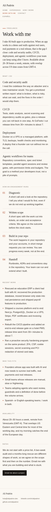 | 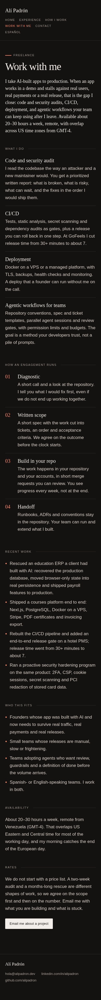 |
| Contact | 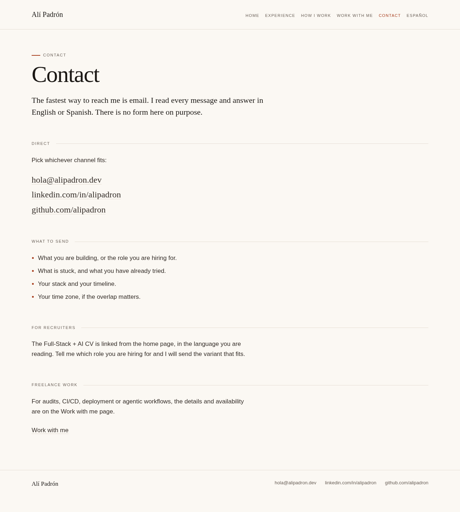 | 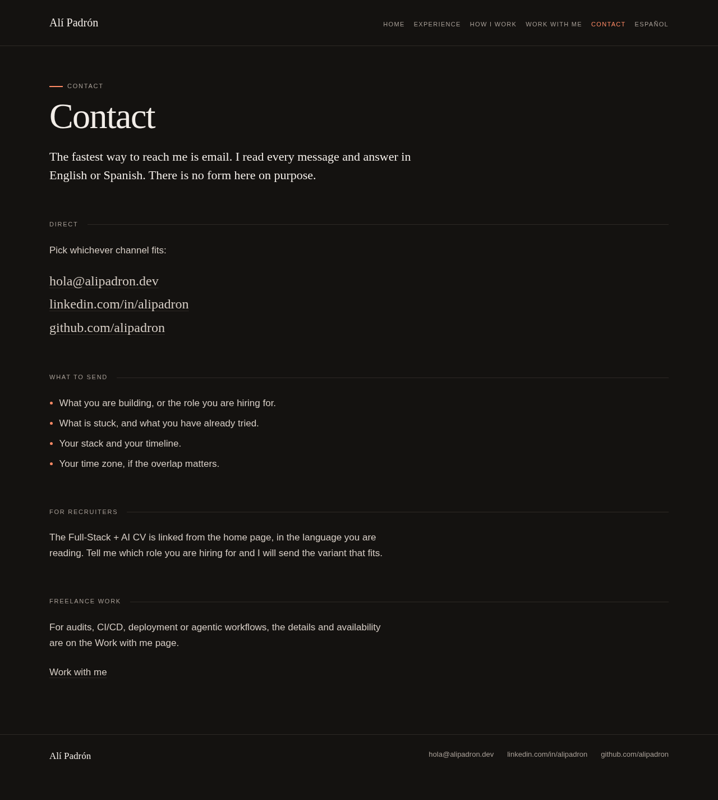 | 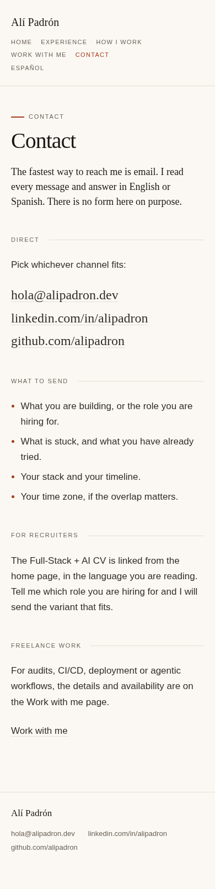 | 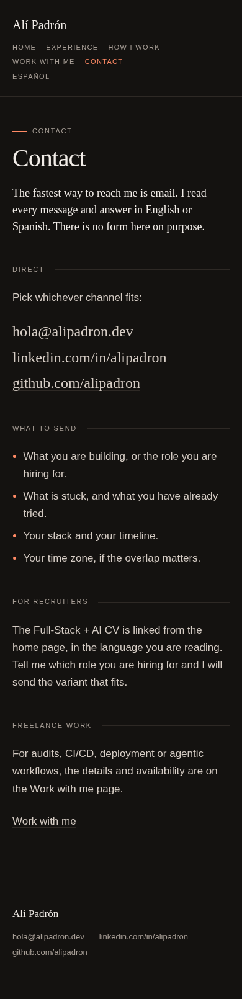 |

Screenshots are of the prerendered build, captured with Playwright. At 390px
the document width stays at 390px (no horizontal scroll).
